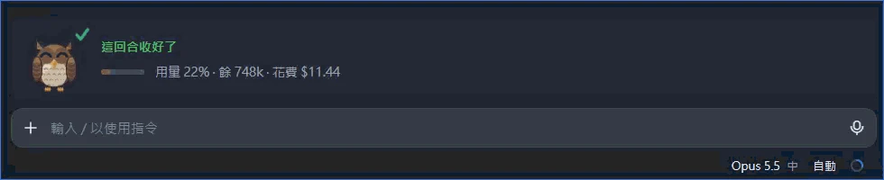
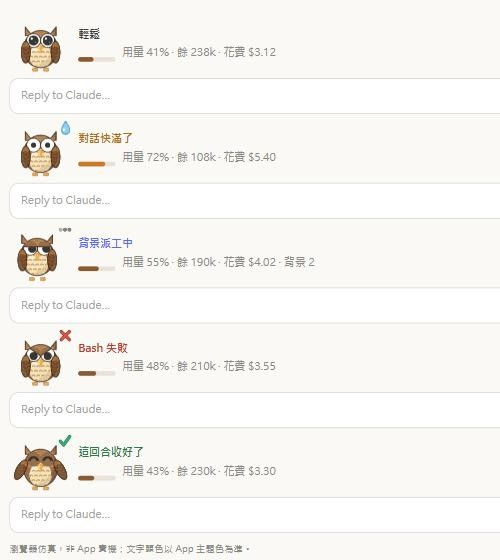
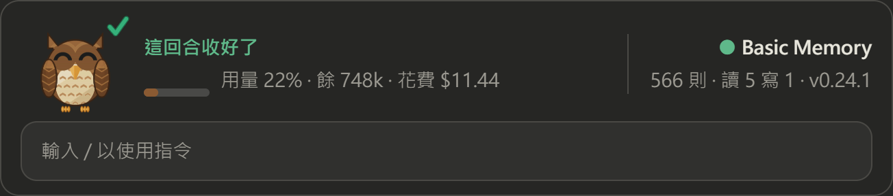
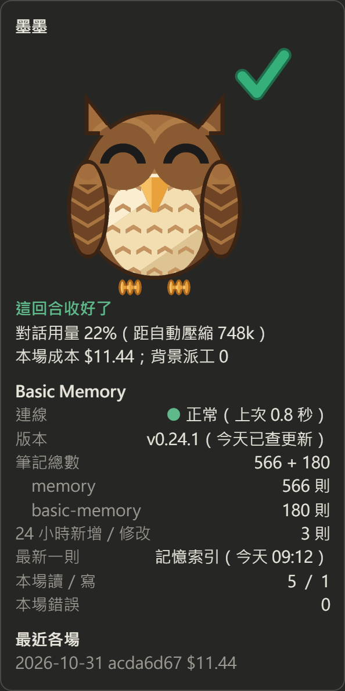

# flynn-mods

Claude Code 桌面 App 的 mod 集。

## flynn-buddy（墨墨）



輸入框上方會出現一隻原創的像素貓頭鷹「墨墨」，旁邊顯示：

- 本場狀態：輕鬆、對話快滿了、背景派工中、工具失敗或被擋、這回合收好了
- 對話用量條、距自動壓縮的餘量、本場花費
- Basic Memory 讀數：連線狀態、筆記數、本場讀寫次數、版本

輸入 `/buddy` 會打開側邊面板，顯示大圖、Basic Memory 詳情和最近各場的成本。

墨墨只讀取狀態：不攔截工具呼叫，也不在對話裡加任何內容。Basic Memory 欄位需要已接上 basic-memory MCP，沒接時顯示「連線失敗」。

權限模式設為「自動」時，墨墨查 Basic Memory 可能被擋，此時欄位會顯示「未獲授權」。要放行，在 `~/.claude/settings.json` 的 `permissions.allow` 加上這 4 個唯讀工具：

```json
"mcp__basic-memory__list_memory_projects",
"mcp__basic-memory__find",
"mcp__basic-memory__recent_activity",
"mcp__basic-memory__basic_memory_diagnostics"
```

## 畫面

五種表情：



加上 Basic Memory 讀數（右側欄）：



`/buddy` 側邊面板：



第一張是 App 實機截圖。其餘是瀏覽器仿真，數字只是示意，實際文字顏色以 App 主題為準。

## 安裝

```bash
claude plugin marketplace add Flynn-Kawolsky/flynn-mods
```

```bash
claude plugin install flynn-buddy@flynn-mods
```

裝完重開 App。

## 授權

MIT，見 [LICENSE](LICENSE)。
